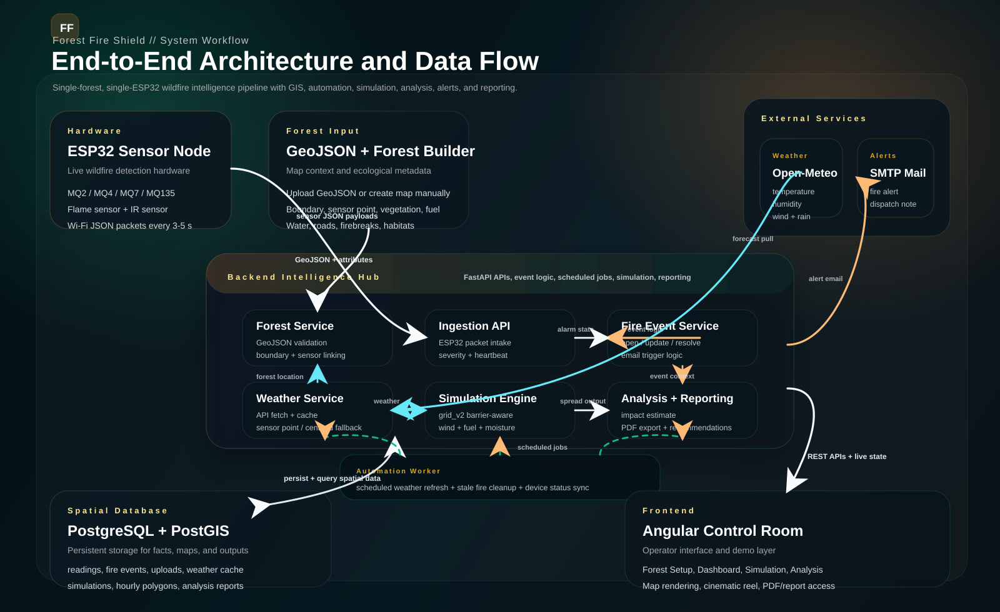

# Forest Fire Shield System Design

## 1. Problem Statement

Build an advanced wildfire monitoring demo for a single forest using one ESP32 node equipped with MQ2, MQ4, MQ7, MQ135, flame, and IR sensors. The system should:

- receive live sensor data from ESP32
- store incoming readings for future analysis
- allow a user to upload or create a forest map in GeoJSON form
- show whether the ESP32 is connected
- enrich the dashboard with weather data from the forest location
- detect fire events
- simulate how the fire may spread over time
- analyze the event after the fire stops
- send email alerts when fire is detected

## 2. High-Level Architecture



```text
ESP32 -> FastAPI ingestion API -> PostgreSQL/PostGIS
                                  -> Realtime stream -> Angular dashboard
                                  -> Weather fetcher
                                  -> Fire event detector
                                  -> Email alert service
                                  -> Simulation engine
                                  -> Post-fire analysis engine
```

## 3. Chosen Technology

### Frontend

- Angular
- Leaflet or OpenLayers for map rendering
- Charting library for sensor and simulation charts

### Backend

- FastAPI for REST APIs and realtime updates
- Background job runner for weather sync, alerts, and simulation tasks

### Database

- PostgreSQL
- PostGIS for forest boundaries, sensor coordinates, affected area polygons, and spatial analysis

## 4. Frontend Modules

### A. Home / Project Overview

- project summary
- current forest status
- device connectivity status
- latest fire state

### B. Forest Map Module

Two entry paths:

- Upload GeoJSON
- Create Your Forest Map

### C. Create Your Forest Map Wizard

The wizard should guide non-technical users through required spatial and ecological details.

Required inputs:

- forest name
- forest boundary polygon
- sensor point location
- latitude and longitude
- vegetation type
- tree density
- canopy density
- surface fuel / dry biomass level
- moisture class
- admin email

Useful optional inputs:

- water bodies
- roads
- trails
- firebreaks
- watch towers
- nearby settlements

Advanced optional inputs:

- animal habitat zones
- slope category
- soil type
- elevation zones

### D. Sensor Dashboard

Show:

- live MQ analog values
- live MQ digital values
- flame sensor status
- IR sensor status
- overall alarm state
- trigger reason
- device heartbeat
- device connectivity status

Weather cards:

- temperature
- humidity
- wind speed
- wind direction
- rainfall / precipitation

### E. Fire Simulation Module

Show:

- ignition point
- spread map after 1, 2, 3, 4, 5, and 6 hours
- predicted affected area
- spread direction
- confidence / assumption note

### F. Fire Analysis Module

Show:

- event start and end time
- response time
- peak sensor readings
- estimated burnt area
- affected vegetation category
- estimated habitat impact
- spread timeline
- final event report

## 5. Backend Services

### A. Ingestion Service

Responsibilities:

- receive ESP32 JSON payload
- validate payload shape
- store raw reading
- update device last-seen timestamp
- trigger fire-event evaluation

### B. Device Status Service

Connectivity rule for demo:

- connected: packet received within 60 seconds
- warning: packet delayed between 60 and 180 seconds
- disconnected: no packet for more than 180 seconds

### C. Weather Service

Use forest or sensor coordinates to fetch:

- current temperature
- current relative humidity
- wind speed
- wind direction
- short-term forecast for simulation

### D. Fire Event Service

Responsibilities:

- open a fire event when readings cross threshold
- keep updating the active event while alarm persists
- close the event after values stabilize for a cooldown period

### E. Simulation Service

Responsibilities:

- build a spread grid from forest geometry and forest attributes
- combine vegetation, dryness, wind, humidity, and terrain assumptions
- generate predicted spread polygons for hourly steps

### F. Analysis Service

Responsibilities:

- summarize the completed fire event
- compare spread prediction with actual affected area if available
- generate estimates for impact and loss
- prepare dashboard cards and printable report data

### G. Notification Service

Responsibilities:

- send alert email when fire event opens
- send update email if severity increases
- send closure summary when event ends

## 6. Recommended Database Design

### forests

- id
- name
- boundary_geom
- center_lat
- center_lon
- vegetation_type
- tree_density
- canopy_density
- fuel_load
- moisture_class
- admin_email
- created_at

### devices

- id
- device_code
- forest_id
- location_geom
- status
- last_seen_at
- created_at

### sensor_readings

- id
- device_id
- recorded_at
- timestamp_ms
- mq2_analog
- mq2_digital
- mq4_analog
- mq4_digital
- mq7_analog
- mq7_digital
- mq135_analog
- mq135_digital
- flame_detected
- ir_detected
- mq_fire
- flame_fire
- alarm
- trigger
- raw_payload

### weather_snapshots

- id
- forest_id
- captured_at
- temperature
- humidity
- wind_speed
- wind_direction
- precipitation
- source_name
- raw_payload

### fire_events

- id
- forest_id
- device_id
- started_at
- ended_at
- status
- trigger_type
- max_severity
- alert_sent

### fire_simulations

- id
- fire_event_id
- generated_at
- model_version
- assumptions_json

### simulation_steps

- id
- simulation_id
- hour_offset
- affected_geom
- estimated_area_m2
- spread_heading
- intensity_score

### impact_reports

- id
- fire_event_id
- generated_at
- estimated_burnt_area_m2
- vegetation_loss_score
- habitat_impact_score
- summary_json

## 7. Simulation Approach

## Recommended approach for this project

Use a rule-based, physics-inspired spread engine first.

Do not start with pure machine learning because:

- you likely do not have a large, high-quality labeled wildfire dataset for your exact forest
- black-box predictions are harder to defend in viva/demo
- a rule-based model is easier to explain academically

### Proposed model inputs

- ignition point from ESP32 location
- vegetation type
- tree density
- canopy density
- fuel load
- moisture class
- wind speed
- wind direction
- humidity
- recent precipitation
- optional slope factor

### Proposed model behavior

1. Convert the forest into a 2D grid or raster.
2. Give each cell a spread resistance based on vegetation and fuel conditions.
3. Increase spread probability in the wind direction.
4. Reduce spread where humidity is high or moisture is high.
5. Slow or stop spread near water bodies and firebreaks.
6. Generate hourly predicted fire polygons.

### Why this is strong for a final-year project

- more realistic than a UI-only animation
- easier to validate and explain
- can be improved later with ML-based calibration

## 8. Analysis Approach

Because this demo does not have direct animal mortality data, show estimated impact instead of exact counts.

Recommended outputs:

- estimated burnt area
- vegetation classes affected
- probable habitat disturbance level
- zones at highest risk
- event duration
- peak alarm intensity
- dominant spread direction

Possible scoring system:

- low impact
- moderate impact
- high impact
- critical impact

## 9. ESP32 Data Flow

Current payload is already close to production-ready.

Recommended enhancements:

- add a real timestamp if NTP is available
- include Wi-Fi RSSI if useful
- include firmware version
- include heartbeat packets even when no fire is detected

Recommended ingestion frequency:

- every 3 to 5 seconds for live monitoring demo

## 10. Alert Workflow

When fire is detected:

1. create or update active fire event
2. send alert email to admin
3. update dashboard status to critical
4. start simulation job
5. store simulation outputs

When fire ends:

1. close fire event
2. generate impact analysis
3. prepare summary report

## 11. Important Academic Notes

To keep the project strong and honest:

- say "simulation" and "impact estimate", not "exact real-world prediction"
- clearly label assumptions used in spread modeling
- separate observed sensor facts from derived predictions

## 12. Delivery Plan

### Phase 1

- backend ingestion API
- PostgreSQL/PostGIS schema
- store sensor readings
- device connectivity status

### Phase 2

- GeoJSON upload
- forest creation wizard
- map rendering

### Phase 3

- live sensor dashboard
- weather integration
- alert email

### Phase 4

- fire event lifecycle
- simulation engine
- simulation playback UI

### Phase 5

- analysis dashboard
- event report generation
- polishing for final demo
